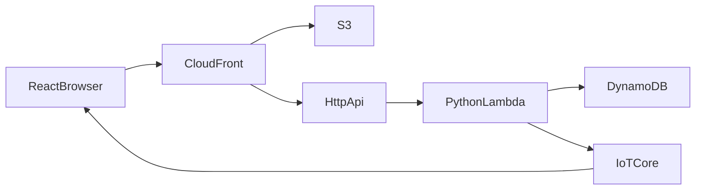

# Architecture overview

Status: recorded by [DISC-004](../tasks/discovery/DISC-004-architecture.md). This page matches the confirmed product.

- Hosting shape: [decision 0002](../decisions/0002-serverless-hosting.md)
- Front door: [decision 0003](../decisions/0003-aws-cloudfront.md)
- Files, request work, and store: [decision 0004](../decisions/0004-s3-lambda-dynamodb.md)

S3, Lambda, and DynamoDB run in Mumbai, `ap-south-1`, per [decision 0005](../decisions/0005-mumbai-region.md). The website is React and the Lambda code is Python, per [decision 0006](../decisions/0006-react-and-python.md). The React app calls Lambda through an HTTP API, per [decision 0007](../decisions/0007-api-gateway-and-live-updates.md). Live notices go through AWS IoT Core, per [decision 0008](../decisions/0008-iot-core-notifications.md).

## What runs

A player uses a browser. The site is on the public internet, so people in different places can open it. The first visit asks for a name and stores that name and a player id in a cookie. The screen shows the name. After that, the player creates a room or joins one. See [decision 0009](../decisions/0009-player-id.md).

CloudFront is the front door for the site and the HTTP API. S3, Lambda, DynamoDB, API Gateway, and AWS IoT Core are in Mumbai (`ap-south-1`). CloudFront stays the global front door. S3 holds the React website. The HTTP API handles create, join, leave before the match starts, load, start, a bid, trump, a card, and the list of matches for this browser's player id. The operations are [the contracts](contracts.md). Python Lambda runs for that action and then stops. It writes the match to DynamoDB and publishes a notice to IoT Core. Players who have the room open are subscribed there, so they see the bid, the card, or the score. A player's own cards go only to that player id's topic. An IoT authorizer, also a Python Lambda, allows a subscription only for a player id that is seated in the room. There is no API Gateway WebSocket, and no container starts when the match begins. Lambda stops between requests. While a player has the room open, IoT Core keeps that MQTT session. When nobody is connected, nothing stays running.

DynamoDB stores every room and its match. Many matches can be in progress at the same time. Each match belongs to its own room. A started match stays after everyone leaves: the date it started, its room id, each seat's player id and name, the seat that bids first in round 1, and each round's points. The dashboard can open that match later by its room id, and it can list the matches this browser's player id played. Public facts about a player use the seat number and the name, so two players can share a name. A player still enters a room by its URL or its room id. The site has no public lobby. The record is [data-model.md](data-model.md).

The match follows `docs/game/rules.md`, enforced in the Python functions. The dashboard in `docs/product/journeys.md` is part of the React website.

## Shape

Python Lambda runs for a request and then stops. IoT Core keeps the MQTT session while the player has the room open. DynamoDB keeps every room and match while Lambda is idle. The first visit stores the player's name and a player id in a cookie in the browser. The screen shows the name. See [decision 0009](../decisions/0009-player-id.md).
