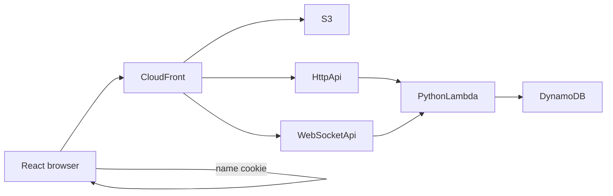

# Architecture overview

Status: recorded by [DISC-004](../tasks/discovery/DISC-004-architecture.md). This page matches the confirmed product.

- Hosting shape: [decision 0002](../decisions/0002-serverless-hosting.md)
- Front door: [decision 0003](../decisions/0003-aws-cloudfront.md)
- Files, request work, and store: [decision 0004](../decisions/0004-s3-lambda-dynamodb.md)

S3, Lambda, and DynamoDB run in Mumbai, `ap-south-1`, per [decision 0005](../decisions/0005-mumbai-region.md). The website is React and the Lambda code is Python, per [decision 0006](../decisions/0006-react-and-python.md). The React app reaches Lambda through API Gateway, per [decision 0007](../decisions/0007-api-gateway-and-live-updates.md).

## What runs

A player uses a browser. The site is on the public internet, so people in different places can open it. The first visit asks for a name and stores it in a cookie. After that, the player creates a room or joins one.

CloudFront is the front door. S3, Lambda, DynamoDB, and API Gateway are in Mumbai (`ap-south-1`). S3 holds the React website. An HTTP API handles create, join, and load. A WebSocket API stays open while a player is in a room. Python Lambda runs for an action and then stops. API Gateway holds the sockets. Lambda posts to those sockets through the API Gateway Management API, so the other players see the bid, the card, or the score. Between requests, and when a room is empty, nothing stays running.

DynamoDB stores every room and its match. Many matches can be in progress at the same time. Each match belongs to its own room. A player still enters a room by its URL or its room id. The site has no public lobby.

The match follows `docs/game/rules.md`, enforced in the Python functions. The dashboard in `docs/product/journeys.md` is part of the React website.

## Shape

Python Lambda runs for a request and then stops. API Gateway keeps the WebSocket open. DynamoDB keeps every room, match, and current connection id while Lambda is idle.
